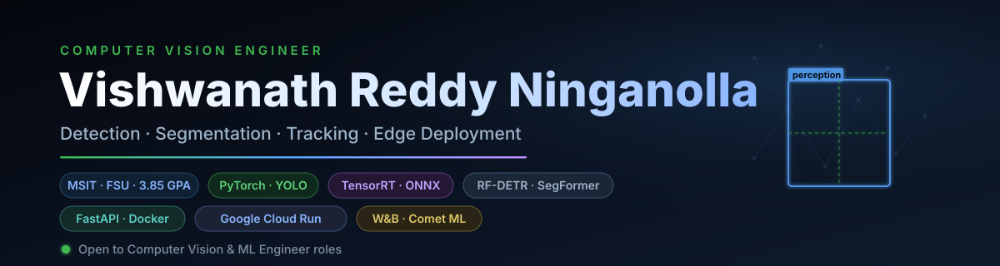
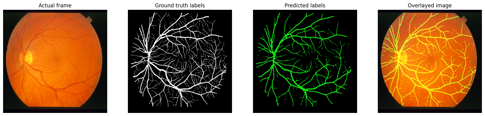

<!-- Banner: upload the new banner.svg to github-profile/assets/banner.svg in this repo -->

  

  
  
  
  

---

## 👋 About Me

I'm a **Computer Vision Engineer** with an **MS in Information Technology from Florida State University** (GPA 3.85, May 2026). I build vision systems end to end: data, training, evaluation and fast deployment.

I work across **detection, segmentation and tracking**, and I care as much about the engineering around the model as the model itself. On my BDD100K pipeline I took inference from ~3.3 FPS to ~14 FPS through pipeline work alone, with no change to the model. On my wildfire smoke project, most of the work went into making the numbers trustworthy: leak-free video splits, label-quality checks and catching a shortcut before it fooled the model.

Before my MS I was a Software Engineer at **HCLTech**, building data pipelines in Python and SQL. I'm **actively looking for Computer Vision and ML Engineer roles in medical imaging, global health, visual inspection, aerial and drone imagery, environmental monitoring, video analytics and sports analytics.**

- 🔭 Building with **YOLO26, RF-DETR, SegFormer, DeepLabV3, EfficientNet, Depth Anything V2**
- ⚡ Optimizing inference with **TensorRT (FP16) and ONNX** for low-latency deployment
- 🧪 Tracking every experiment with **Weights & Biases / Comet ML**
- 📫 Reach me at **vrninganolla@gmail.com**

---

## 🔬 Featured Projects

### 🚗 Autonomous Traffic Perception: BDD100K Pipeline (TensorRT)
> **YOLO26l · YOLO26l-seg · Depth Anything V2 · TensorRT FP16 · NVIDIA A100/T4**

A production-grade, multi-task driving perception pipeline on the **BDD100K** dataset. Runs **object detection (9 classes), drivable-area segmentation and monocular depth** at the same time on 1080p driving video, then optimized end to end with TensorRT.

**Detection mAP50: 56.3% · Drivable-area Mask mAP50: 91.8% · ~14 FPS at 1080p.** Pipeline engineering alone took throughput from **3.3 → 14 FPS (4.3×)** with zero model changes.

🔗 **[Repository](https://github.com/523vishwanath/Autonomous-Traffic-Perception)** · ▶️ **[Full demo on YouTube](https://www.youtube.com/watch?v=PDP2xSCtjgk)**

---

### 🔥 Wildfire Smoke Detection, Segmentation & Tracking from Drone Video
> **YOLO26m · YOLO26m-seg · BoT-SORT · Gradio · RunPod RTX 4090**

Smoke detection and segmentation on the **Boreal Forest Fire** UAV dataset (4K drone video of four prescribed burns in Finland), extended into a video system that tracks smoke over time and raises alerts through a web dashboard where you can upload a video.

**Detection: 0.933 mAP50 / 0.644 mAP50-95 on held-out videos · Segmentation: 0.839 pixel IoU, on par with SAM against hand-drawn masks.** Built a leak-free, video-level split after a near-duplicate check flagged 140 of 1,014 test images, and cut epoch time from ~9 to ~2 minutes by fixing a 7% GPU-utilization data bottleneck.

🔗 **[Repository](https://github.com/523vishwanath/Boreal-wildfire-smoke)**

---

### 🦟 VectorID: Mosquito Species & Sex Classifier
> **EfficientNet-B0 (multi-head) · PyTorch · FastAPI · Google Cloud Run · Comet ML**

A two-head classifier (7 species, 2 sexes) replicating the architecture behind **VectorCam**, the Johns Hopkins platform for AI-assisted malaria vector surveillance. Carried end to end: data pipeline → multi-task training → containerized API → cloud deployment → live web front end. A follow-up version runs a field classifier (EfficientViT-B0) fully on-device.

**Species accuracy: 89.4% · Sex accuracy: 92.6%** (with test-time augmentation).

🔗 **[Repository](https://github.com/523vishwanath/VectorCam_Mosquito_classifier)** · 🌐 **[Try the live web app](https://523vishwanath.github.io/VectorCam_Mosquito_classifier/)** · 📱 **[On-device version](https://github.com/523vishwanath/vectorid-ondevice)**

---

### 🎾 Tennis Match Analysis: Ball Tracking, Bounces & Court Mapping
> **WASB Ball Tracking · YOLO · Homography · OpenCV · PyTorch**

Turns a match video into tennis analytics: tracks the ball in play, finds every bounce, makes **IN / OUT calls in real court meters**, rebuilds the court from 4 inner keypoints (auto-corrected to the real white lines), detects the net and estimates average shot speed per player.

**On test footage the ball is found in 91% of frames with a 3-frame WASB model, up from ~10% with the YOLO ball model I started with.** Built on top of [abdullahtarek/tennis_analysis](https://github.com/abdullahtarek/tennis_analysis).

🔗 **[Repository](https://github.com/523vishwanath/Tennis_Analysis_Project)** · ▶️ **[Demo on YouTube](https://youtu.be/pYBIH82ymb0)**

---

### ⚡ Power Line Asset Detection for UAV Inspection: RF-DETR
> **RF-DETR (Detection Transformer) · InsPLAD-det · COCO mAP · PyTorch**

Fine-tuned **RF-DETR** to detect and classify **17 fine-grained transmission-line hardware components** (insulators, dampers, shackles, spacers, yokes, tower ID plates) from high-resolution drone imagery. This is the perception layer that makes large-scale, AI-assisted line inspection possible.

**mAP50: 94.6% · mAP50-95: 76.9% · Precision/Recall ≈ 91%.**

🔗 **[Repository](https://github.com/523vishwanath/Power-Line-Asset-Detection-for-Automated-UAV-Inspection)**

---

### 🩺 Retinal Blood Vessel Segmentation: SegFormer
> **SegFormer-B3 · Albumentations · Mixed Precision · Weights & Biases · NVIDIA A100**

Fine-tuned SegFormer-B3 on retinal fundus images with a custom **Dice + Cross-Entropy loss** to handle severe class imbalance (~10% vessel pixels).

**78.02% mIoU** across thin and thick vessel structures.

🔗 **[Repository](https://github.com/523vishwanath/retinal-vessel-segmentation)**

---

### 🚦 Real-Time Traffic Signal State Recognition: YOLOv8
> **YOLOv8l · TensorRT FP16 · NVIDIA A100**

Detects small, distant traffic lights (**Red / Yellow / Green / Wait-On**) in real driving footage, with a data-centric approach: bounding-box-guided cropping, label cleanup and merging a noisy 7-sample class.

**Precision 96.7% · Recall 93.2% · mAP50 96.3% · mAP50-95 43.6 → 54.2 after label correction · ~4.9 ms/image with TensorRT FP16.**

🔗 **[Repository](https://github.com/523vishwanath/Real-Time-Traffic-Signal-State-Recognition-Red-Yellow-Green-with-YOLOv8)**

---

### 🛰️ Aerial Drone Image Segmentation: DeepLabV3
> **DeepLabV3-ResNet101 · Dice + CE Loss · Albumentations · Kaggle Competition**

12-class semantic segmentation of drone aerial imagery, built for the OpenCV × PyTorch Kaggle competition. Combined Dice + Cross-Entropy loss with an auxiliary head to handle heavy class imbalance (sky/vegetation/road vs. tiny people/bikes/animals).

**Kaggle leaderboard: 0.57 Dice** across all 12 classes.

🔗 **[Repository](https://github.com/523vishwanath/Aerial-Drone-Image-Segmentation)**

---

## 🛠️ Tech Stack

**Languages**

**Computer Vision & Deep Learning**

**Model Architectures**

`YOLO26 / YOLOv8` · `RF-DETR` · `DETR / RT-DETR` · `SegFormer` · `DeepLabV3` · `EfficientNet / EfficientViT` · `ViT` · `Depth Anything V2` · `CNNs`

**Deployment & MLOps**

`Comet ML` · `FiftyOne` · `Roboflow` · `Gradio` · `RunPod`

**Techniques**

`Mixed Precision (AMP)` · `SAHI Sliced Inference` · `Dice + CE Loss` · `Multi-Task Learning` · `TensorRT FP16 Optimization` · `Multi-Object Tracking (BoT-SORT)` · `Homography` · `Leak-free Video Splits` · `Data Augmentation Pipelines` · `mIoU / mAP Evaluation`

---

## 💼 Experience

**HCLTech · Software Engineer** · *Sep 2022 - Aug 2024*  
Built scalable data analysis pipelines in Python and SQL, created visualization dashboards on Google PLX, and led Agile sprint execution as POD Lead for a team of engineers.

**Capgemini · Software Engineer Intern** · *Feb 2022 - Aug 2022*  
Engineered backend modules for a Java-based banking system with MySQL/JDBC integration.

---

## 🎓 Education

**Florida State University** · *Master of Science in Information Technology (MSIT)*  
GPA 3.85 · May 2026 · Focus: Computer Vision and Deep Learning

**Malla Reddy College of Engineering and Technology, Hyderabad** · *B.Tech in Information Technology*  
2022

---

## 🏅 Certifications

- Advanced Vision Applications with Deep Learning & Transformers
- Deep Learning with PyTorch 2.x
- Computer Vision & Image Processing in Python (OpenCV University)
- Machine Learning Specialization

---

## 📊 GitHub Stats

  
  

---

## 📫 Connect

  
  
  

  

